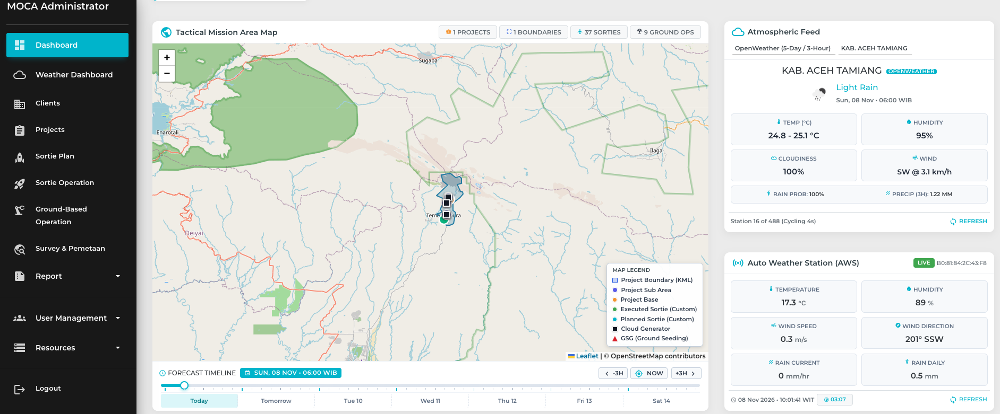

MOCA Operation Portal is an operational management platform designed for weather modification projects. The system aggregates predictions from multiple forecasting models alongside real-time feeds from Automatic Weather Stations (AWS), augmented by AI analytics to help meteorologists and mission planners execute high-precision operations. Additionally, the platform features a customizable automated reporting module that schedules and distributes mission reports to specified stakeholders.
{.img-lg .mx-auto .rounded-lg}